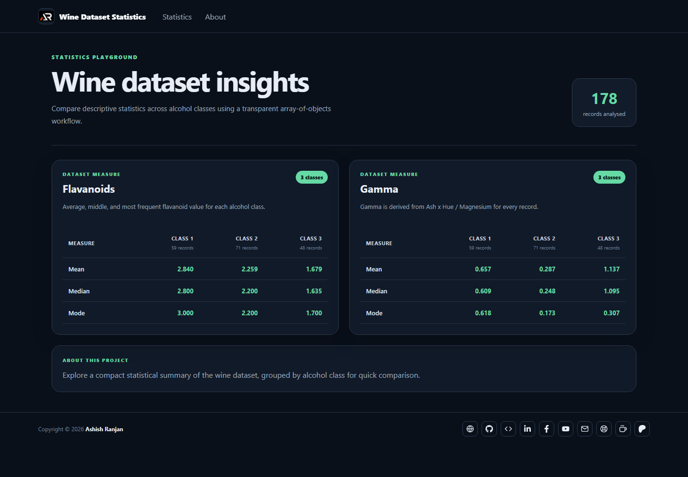

# Wine Dataset Statistics

A responsive React dashboard that compares mean, median, and mode for selected chemical measurements across the three cultivar classes in the UCI Wine dataset.



## Features

- Displays statistics for flavanoids and gamma by cultivar class.
- Calculates gamma as `Ash × Hue ÷ Magnesium` for each record.
- Reports every tied mode and labels a dataset with no repeated values as **No mode**.
- Includes all 178 source records and validates each row when loading the data.
- Adapts to mobile screens and supports keyboard-accessible navigation.

The dataset's first column is the cultivar class. It is distinct from the `Alcohol` feature, so classes are not alcohol ranges.

## Dataset and attribution

This project includes the [Wine dataset](https://archive.ics.uci.edu/dataset/109/wine) from the UCI Machine Learning Repository. The dataset contains 178 records, three cultivar classes, and 13 chemical features. It is licensed under [Creative Commons Attribution 4.0 International (CC BY 4.0)](https://creativecommons.org/licenses/by/4.0/). Dataset file: [`src/files/wine.data`](src/files/wine.data).

## Tech stack

React, Vite, and React Icons.

## Run locally

Requires Node.js 20.19 or later.

```bash
npm install
npm run dev
```

Create a production build with `npm run build`, preview it with `npm run preview`, or publish the `dist` directory to GitHub Pages with `npm run deploy`.

## Links

- Live: https://a2rp.github.io/calculate-mean-median-mode-from-array-of-objects/
- Repository: https://github.com/a2rp/calculate-mean-median-mode-from-array-of-objects
- Portfolio: https://www.ashishranjan.net/
- GitHub: https://github.com/a2rp
- CodePen: https://codepen.io/ash1198
- LinkedIn: https://www.linkedin.com/in/aashishranjan
- Facebook: https://www.facebook.com/theash.ashish/
- YouTube: https://www.youtube.com/@ashishranjan-ashz?sub_confirmation=1
- Email: mailto:ash.ranjan09@gmail.com

## Support

- Support: https://a2rp-donation-page.netlify.app/
- Buy Me a Coffee: https://buymeacoffee.com/a2rp
- Patreon: https://www.patreon.com/a2rp
